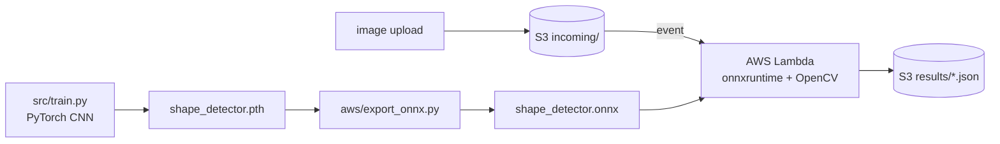

# Solid Object Detection & Identification

[](https://github.com/Deshraj-Jogiya/Solid-Object-Detection-and-Identification-using-Image-Processing/actions/workflows/ci.yml) 

Classifies geometric shapes in images by combining a custom PyTorch CNN with classic OpenCV contour geometry, and serves the trained model
on AWS Lambda: an image uploaded to S3 triggers classification and the result is written back to S3.

## Highlights

- **99.2% accuracy** on the 2,000 held-out images of a 10,000-image generated set across 7 classes (target: 98.97%) from the CNN;
  contour geometry independently confirms the CNN on 66% of images, and those confirmed predictions are 99.9% correct; CI regenerates the set and fails if accuracy drops below the target.
- **Preprocessing:** Gaussian blur and Canny edge detection extract shape boundaries before classification; results are drawn as bounding
  boxes and labels.
- **Serverless inference:** the model is exported to ONNX (about 615 KB) and runs in a plain Lambda zip with `onnxruntime`, avoiding a
  PyTorch container image and its ECR storage cost.
- **Tested against AWS:** a unit test runs the Lambda handler locally, and an integration test in CI uploads to S3 and reads back the
  deployed Lambda's result.

## Architecture



## Data

The images are generated by `src/dataset.py` (`generate_shape_dataset`, seed 42): 10,000 shapes across 7 classes (circle, square,
triangle, rectangle, pentagon, hexagon, star) drawn with OpenCV at random sizes, positions, rotations and colours, some on a gradient
background to imitate uneven lighting.

## Stack

Python, PyTorch, OpenCV, ONNX Runtime, AWS Lambda, Amazon S3, GitHub Actions.

## Run it

```bash
pip install -r requirements.txt
python main.py                       # local detection
python -m unittest discover -s tests -v

pip install -r aws/requirements.txt
python -m unittest aws.test_lambda_function -v
```

`aws/deploy.py` deploys the Lambda and the S3 trigger; the integration test (`aws.test_s3_integration`) needs AWS credentials.
